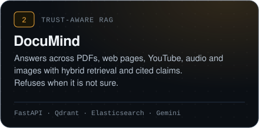
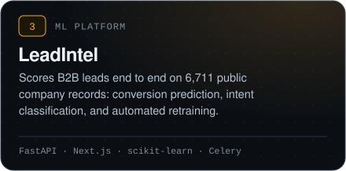
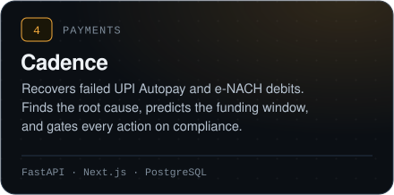

  

  

  <a href="https://omkarbandikatte.tech/resume">Resume</a> ·
  <a href="https://linkedin.com/in/omkarbandikatte">LinkedIn</a> ·
  <a href="mailto:omkarbandikatte2602@gmail.com">Email</a> ·
  <a href="https://kaggle.com/omkarbandikatte">Kaggle</a> ·
  <a href="https://www.leetcode.com/u/omkarbandikatte">LeetCode</a>

 

## The grounded answer

I build retrieval systems that cite their sources, so this README does the same. Every claim below points at something you can open.

> **Omkar is an AI and full-stack engineer in Mumbai who builds AI systems that ship.** He built a supply-chain security tool that audits dependencies without running them [[1]](https://provenyx.vercel.app), a research assistant that cites every claim and refuses when it does not know [[2]](https://github.com/omkarbandikatte/MDIA-Multi-Document-Intelligence-Assistant), and a lead-scoring platform that retrains itself [[3]](https://github.com/omkarbandikatte/LeadIntel). He has also built for payments [[4]](https://github.com/omkarbandikatte/cadence), road safety [[5]](https://github.com/omkarbandikatte/DriverDrowsinessDetectionSystem), and hiring [[6]](https://github.com/omkarbandikatte/fairhire).
>
> He is a final-year B.Tech student in CSE (Data Science) at DJSCE, Class of 2027. He interned as a Software Engineer at Periscope Technologies on backends, data pipelines, and LLM-assisted automation for an e-commerce analytics platform, works on AI backends for a healthcare platform (voice, real-time streaming, function calling), and runs events at DJS Codestars.

`sources: 6` &nbsp; `grounded: yes` &nbsp; `hallucinations: none found`

 

## Sources

The six documents retrieved for the answer above. Click a card to open it.

  
  

  
  

  
  

  Live demos: <a href="https://provenyx.vercel.app">Provenyx</a> · <a href="https://driver-drowsiness-detection-system-sage.vercel.app">DriveSafe</a> · <a href="https://v0-ai-interview-assistant-theta.vercel.app/">FairHire</a>

<b>Lower-ranked results</b>

 

- **[Kheti](https://github.com/omkarbandikatte/Kheti)**: agricultural AI with a 3D voice avatar for crop recommendations, government schemes, and plant disease detection. *React Three Fiber, ElevenLabs, Groq*
- **[AI Video Summarizer](https://github.com/omkarbandikatte/AIVideoSummarizer)**: turns YouTube transcripts into summaries, key takeaways, and exam-style questions. *Streamlit, Groq*
- **[Shanti.ai](https://github.com/omkarbandikatte/Shanti.ai)**: a mental-health support chatbot for students. *Python, Gemini*
- [All repositories](https://github.com/omkarbandikatte?tab=repositories)

 

## How I build

My stack, laid out the way data actually moves through the things I ship.

  

<b>The same stack as plain text</b>

 

| | |
|---|---|
| **Languages** | Python, TypeScript, JavaScript, Java, SQL |
| **AI / ML** | LLM APIs (OpenAI, Gemini, Groq), RAG, tool-calling agents, Qdrant, Elasticsearch, Hugging Face, PyTorch, TensorFlow, scikit-learn, OpenCV, MediaPipe, Whisper |
| **Backend** | FastAPI, Flask, Node.js, Express, Celery, Kafka, Playwright, WebSockets |
| **Data** | PostgreSQL, MongoDB, MySQL, Redis |
| **Frontend** | React, Next.js, Tailwind CSS, React Three Fiber, Streamlit |
| **Cloud and tools** | Azure, AWS, Docker, GitHub Actions, Vercel, Firebase, Postman, Git |

 

## Evals

| Benchmark | Result |
|---|---|
| Digital Healthcare Hackathon (Periscope) | **1st Runner-Up** |
| Xtract 3.0 Data Science Competition | **2nd Runner-Up** |
| Sustainability Hackathon | **Winner** |
| HackWithMumbai | **Top 10** |
| LeetCode | **1658**, top 17% globally |
| CodeChef | **1388** peak |
| Certifications | AWS Academy Cloud Foundations · Postman API Fundamentals Student Expert · Deloitte Data Analytics Simulation |

Raw logs: [LeetCode](https://www.leetcode.com/u/omkarbandikatte) · [CodeChef](https://www.codechef.com/users/bandikatte) · [Codeforces](https://codeforces.com/profile/omkarbandikatte2602) · [Codolio](https://codolio.com/profile/omkarbandikatte)

 

## Out of context?

If your question is not answered above, this README will not guess. Ask the source directly.

  

  Open to <b>AI engineering</b> and <b>full-stack AI</b> roles, internships, and collaborations. 
  <a href="mailto:omkarbandikatte2602@gmail.com">omkarbandikatte2602@gmail.com</a> · <a href="https://linkedin.com/in/omkarbandikatte">LinkedIn</a>

